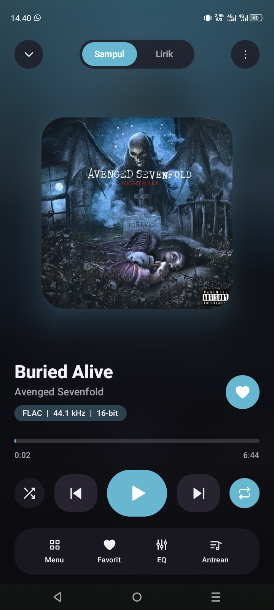
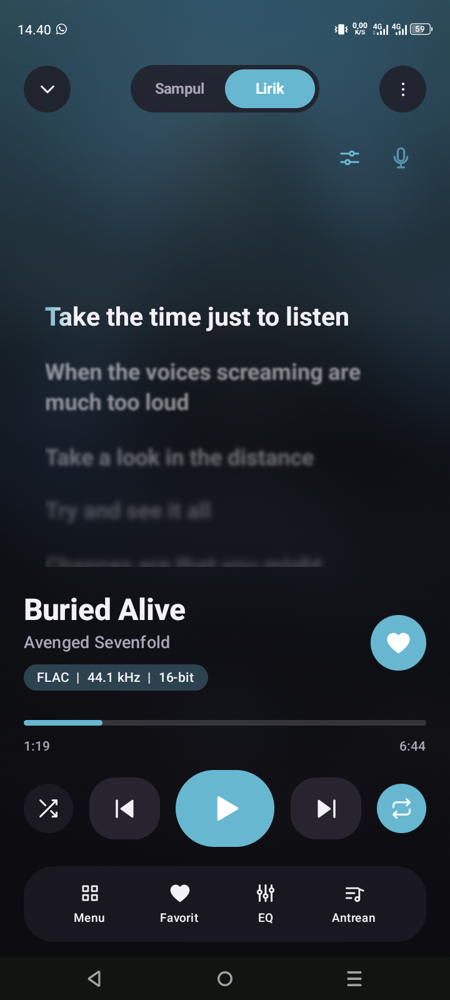
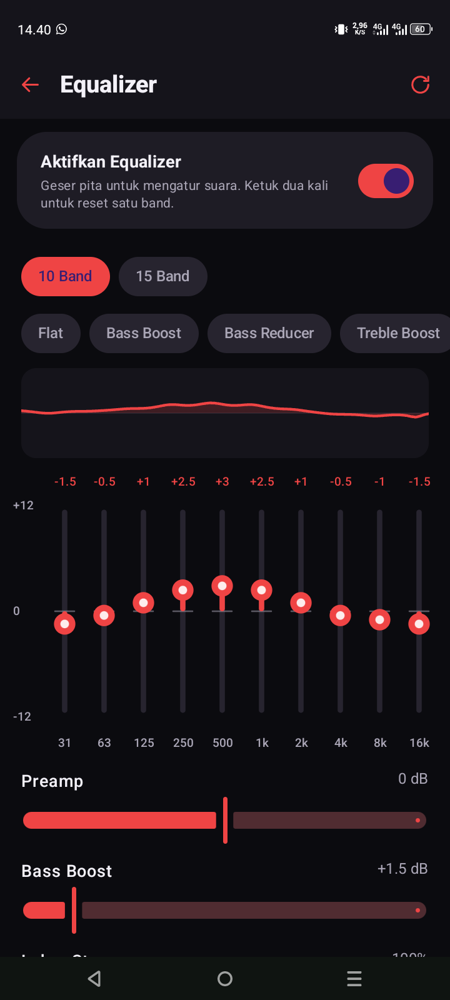
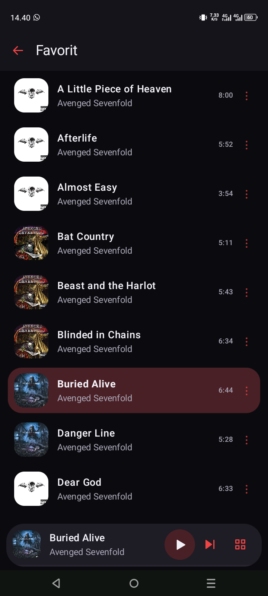

# Lightweight Music Player

Pemutar musik Android yang ringan untuk file audio di perangkat, dengan **equalizer multi-band**, **lirik tersinkron bergaya Apple Music / Spotify**, dan **mode bit-perfect**. Dibangun dengan Kotlin, Jetpack Compose (Material 3 / Material You), dan Media3 (ExoPlayer).

<p align="center">
  
</p>

<p align="center">
  
  
  
</p>

## Tampilan

<table>
  <tr>
    <td align="center"><br/><sub><b>Now Playing</b><br/>aksen dari sampul album</sub></td>
    <td align="center"><br/><sub><b>Lirik tersinkron</b><br/>efek karaoke halus</sub></td>
    <td align="center"><br/><sub><b>Equalizer</b><br/>10 / 15 band</sub></td>
    <td align="center"><br/><sub><b>Favorit</b><br/>daftar lagu dan mini player</sub></td>
  </tr>
</table>

## Fitur

**Pemutaran**
- Library lagu, album, dan artis dari MediaStore; pencarian dan pengurutan (judul, artis, album, durasi)
- Antrean, "Putar berikutnya", "Tambah ke antrean", shuffle, repeat, tombol "Putar semua" dan "Acak"
- Playlist dan favorit
- Sleep timer: 5 menit sampai 2 jam, durasi kustom, atau "akhir lagu ini"; volume memudar pelan dan timer tetap jalan walau app ditutup
- Kecepatan putar 0,5x sampai 2x tanpa mengubah nada
- Crossfade antar lagu
- Notifikasi media dan kontrol layar kunci (Media3 `MediaSessionService`) dengan sampul album HD, ikon status bar kustom, dan sampul bawaan bila lagu tidak punya sampul
- Widget layar utama (4x2, bisa diubah ukuran): sampul membulat, judul, artis, dan tombol sebelumnya / putar-jeda / berikutnya berwarna aksen sampul
- Antrean, posisi, shuffle/repeat, dan kecepatan dipulihkan setelah app ditutup
- Sambung ulang otomatis ke service pemutar bila sempat mati

**Equalizer**
- 10 band atau 15 band, dengan slider vertikal yang bisa digeser (ketuk dua kali untuk reset satu band)
- 16 preset, preamp, bass boost, lebar stereo, dan kurva respons frekuensi
- Diproses langsung di jalur audio (biquad filter), jadi tidak dibatasi jumlah band perangkat
- Headroom otomatis dan soft limiter agar boost tidak pecah

**Lirik**
- Lirik tersinkron (LRC) dengan efek karaoke yang halus: warna aksen mengisi bertahap per baris
- Baris lain mengecil, meredup, dan ter-blur menurut jaraknya; scroll otomatis dengan kurva halus
- Ketuk baris untuk loncat ke bagian itu
- Pilih versi lirik yang pas dari hasil pencarian LRCLIB, dan geser waktu lirik per lagu
- Mode karaoke (pengurangan vokal)

**Tampilan**
- Material You: warna dinamis dari wallpaper (Android 12+), atau aksen pilihan sendiri
- Aksen mengikuti warna dominan sampul album di layar Now Playing
- Set ikon kustom bergaya garis membulat
- Info format lagu (mis. `FLAC | 96 kHz | 24-bit`)

**Mode Bit-Perfect**
- Melewati equalizer, karaoke, crossfade, dan perubahan kecepatan; volume pemutar dikunci
- File hi-res 24/32-bit keluar sebagai float agar presisinya terjaga
- Android 14+ dengan DAC USB: meminta mixer bit-perfect dari sistem, dengan status aktual di Setting
- Catatan: bit-perfect sampai ke DAC hanya terjadi bila perangkat dan DAC mendukung formatnya

## Teknologi

| Bagian | Pustaka |
| --- | --- |
| UI | Jetpack Compose, Material 3 |
| Pemutaran | Media3 ExoPlayer, Media3 Session |
| Audio DSP | `AudioProcessor` kustom (equalizer biquad, karaoke) |
| Lirik online | [LRCLIB](https://lrclib.net) |
| Bahasa | Kotlin |

Konfigurasi: `compileSdk 34`, `minSdk 24`, `targetSdk 34`, package `com.txc.mp`.

## Struktur proyek

```
app/
  module.toml                      konfigurasi build (dependensi, SDK, build type)
  src/main/
    AndroidManifest.xml
    kotlin/com/txc/mp/
      MainActivity.kt              navigasi antar layar
      MpApplication.kt             inisialisasi, pencatat crash terakhir
      playback/                    service, controller, equalizer, bit-perfect, sleep timer
      widget/                      widget layar utama
      data/                        repository (MediaStore, lirik, playlist, pengaturan)
      ui/
        screens/                   Now Playing, Library, Lirik, Equalizer, Setting, Menu
        components/                item daftar, ikon kustom, mini player
        theme/                     tema Material You dan aksen dari sampul
    res/                           ikon adaptif, string, tema
```

## Build dan jalankan

Proyek ini dikonfigurasi lewat `app/module.toml` (dipakai IDE seperti CodeAssist).

1. Salin atau clone repo ke perangkat/IDE yang mendukung `module.toml`.
2. Build varian `debug`, lalu pasang APK-nya.
3. Beri izin akses audio dan notifikasi saat pertama kali dibuka.

## Izin

| Izin | Kegunaan |
| --- | --- |
| `READ_MEDIA_AUDIO` / `READ_EXTERNAL_STORAGE` | Membaca file musik |
| `POST_NOTIFICATIONS` | Notifikasi kontrol pemutar (Android 13+) |
| `FOREGROUND_SERVICE_MEDIA_PLAYBACK`, `WAKE_LOCK` | Memutar di latar belakang |
| `MODIFY_AUDIO_SETTINGS` | Mixer bit-perfect untuk DAC USB |
| `INTERNET` | Mengambil lirik dari LRCLIB |

## Mengatasi masalah

- **App crash:** buka **Setting > Laporan crash terakhir**, lalu salin isinya saat melaporkan masalah.
- **Equalizer tidak terdengar:** di layar Equalizer, baris "Jalur audio" menunjukkan apakah prosesor terpasang dan sedang memproses audio. Pastikan Mode Bit-Perfect mati.
- **Lirik terasa telat atau cepat:** buka layar lirik, ketuk ikon pengaturan, lalu geser waktunya atau pilih versi lirik lain.

## Kontribusi

Issue dan pull request dipersilakan. Untuk perubahan besar, buka issue dulu agar bisa didiskusikan.

## Lisensi

Proyek ini open source di bawah [Lisensi MIT](LICENSE). Kamu bebas memakai, mengubah, dan membagikannya, selama menyertakan pemberitahuan hak cipta dan lisensinya.
